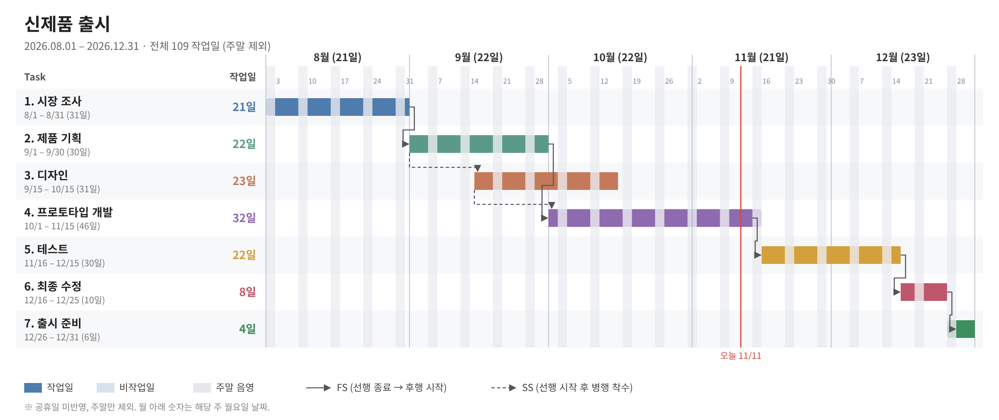
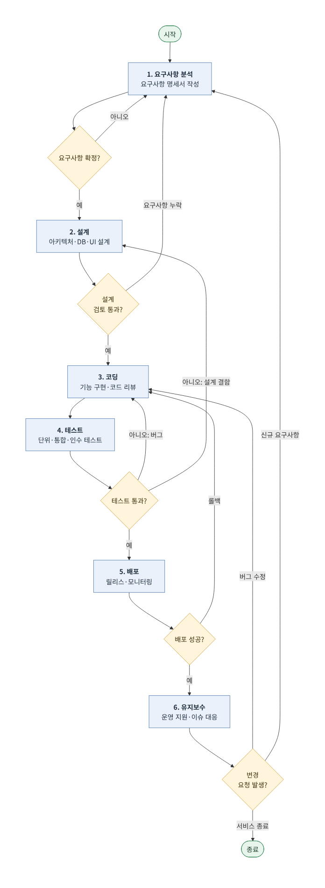
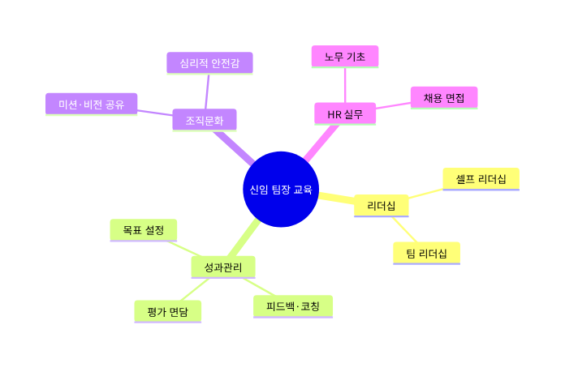
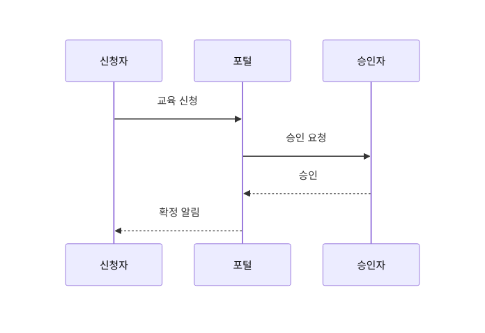
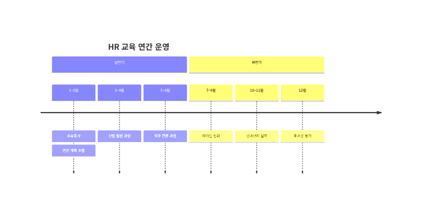
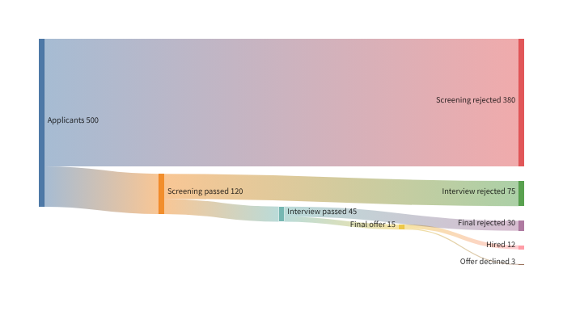

# show-me-diagram-mcp

Remote MCP server that renders Mermaid diagrams from natural-language prompts — flowchart, gantt, mindmap, timeline, sankey, sequence.

AI에게 말로 설명하면 렌더링해주는 Mermaid 다이어그램 MCP 서버. Claude · ChatGPT · Gemini · 젠스파크 등 원격 MCP를 지원하는 어떤 AI에서도 쓸 수 있다. (Python + FastMCP, Vercel 배포)

| 도구 | 하는 일 | 대응 Claude 스킬 |
|---|---|---|
| `render_mermaid` | Mermaid 소스 정리(유형 보정·코드블록 제거) → 이미지·편집 URL | diagram-render |
| `make_flowchart` | 단계·의사결정·루프 구조 → 순서도 소스 + URL | process-flowchart |
| `gantt_chart` | Task 일정 → 주말·공휴일 제외 작업일, 상세 SVG, 이미지 URL | gantt-svg |

## 예시 (Examples)

아래 이미지는 모두 이 서버의 도구가 만든 결과를 실제 렌더링한 것이다. 사용한 Mermaid 코드는 [`docs/examples.json`](docs/examples.json)에 있다.

### Gantt chart — `gantt_chart`
> "신제품 출시 일정(8/1~12/31, Task 7개)으로 간트차트 그려줘. 주말 빼고 작업일 기준으로, 의존성도 표시해서."



주말 제외 작업일 계산, 일정으로 FS(종료→시작)·SS(시작→시작) 의존성 자동 추정, 오늘 표시선. 원본 SVG: [`docs/images/gantt.svg`](docs/images/gantt.svg)

### Flowchart — `make_flowchart`
> "요구사항 분석부터 유지보수까지 소프트웨어 개발 프로세스 순서도. 의사결정은 다이아몬드로, 버그·신규 요구사항으로 다시 도는 루프도 표현해줘."



### Mindmap — `render_mermaid`
> "신임 팀장 교육 커리큘럼을 마인드맵으로."



### Sequence diagram — `render_mermaid`
> "교육 신청 → 승인 → 확정 알림 흐름을 시퀀스 다이어그램으로."



### Timeline — `render_mermaid`
> "HR 교육 연간 운영 일정을 타임라인으로."



### Sankey — `render_mermaid`
> "Recruiting funnel: 500 applicants → screening → interview → offer → hired."



> ⚠️ Mermaid sankey는 라벨에 영문·숫자(ASCII)만 지원한다(Mermaid 11 기준, 따옴표·문자코드로도 우회 불가). 한글 라벨이 들어오면 서버가 원인과 대안을 담은 오류를 돌려준다.

## 구조
```
show-me-diagram-mcp/
├─ server.py               # MCP 서버·도구 정의 + ASGI `app` (Vercel 자동 인식)
├─ diagram_tools/
│  ├─ mermaid.py           # 소스 정리, mermaid.ink URL 생성
│  ├─ flowchart.py         # 순서도 설계 규칙 → Mermaid
│  └─ gantt.py             # 작업일 계산, 의존성 추정, SVG
├─ tests/test_tools.py
└─ requirements.txt
```
Transport: Streamable HTTP (stateless) · Python + FastMCP · Vercel

## 로컬 실행
```bash
python -m venv .venv && source .venv/bin/activate
pip install -r requirements.txt
python tests/test_tools.py      # 테스트 5개
python server.py                # http://localhost:8000/mcp
```

배포 시에는 환경변수 `MCP_SECRET`(16자 이상)을 설정해야 MCP가 열리며, 엔드포인트는 `/mcp/<MCP_SECRET>`이 된다. 미설정이면 배포 환경에서 MCP는 비활성화된다.
